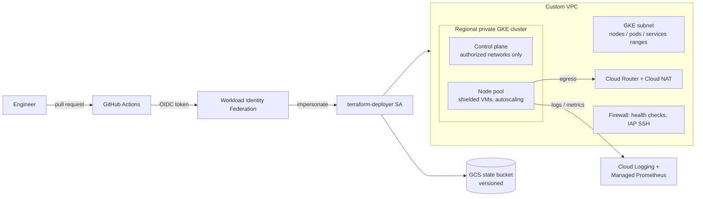

# GCP GKE Landing Zone

A production-style, security-hardened GKE platform on Google Cloud, built with modular Terraform and deployed by GitHub Actions through **reusable workflows** and **keyless authentication** (Workload Identity Federation).

It is the baseline I use when standing up Kubernetes platforms for enterprise and regulated workloads: private nodes, no service account keys, least-privilege identities, and every change planned and reviewed in a pull request before it is applied.

## Architecture



## What's inside

| Area | Implementation |
| --- | --- |
| Network | Custom VPC, subnet with secondary ranges for pods and services, Private Google Access, VPC flow logs, Cloud NAT for private-node egress |
| Cluster | Regional (multi-zone) private GKE, Dataplane V2 (eBPF, built-in NetworkPolicy), REGULAR release channel, weekend maintenance window |
| Identity | Dedicated node service account with 5 minimal roles, Workload Identity for pods, no client certificates, optional Google Groups RBAC |
| Security | Shielded nodes (secure boot, integrity monitoring), Binary Authorization, GKE security posture scanning, master authorized networks |
| Operations | Node auto-repair and auto-upgrade, surge upgrades with zero unavailable nodes, Managed Prometheus, workload logging |
| CI/CD | Reusable workflows for Terraform and IaC scanning; PR = plan posted as a comment, merge to main = apply behind an environment gate |
| Policy | TFLint (Google ruleset) and Checkov; current result 63 passed, 0 failed, 3 documented skips |

## Repository layout

```
.
├── modules/
│   ├── network/          # VPC, subnet, NAT, firewall
│   └── gke/              # private GKE cluster, node pool, node SA
├── envs/
│   └── dev/              # root module wiring the modules together
├── scripts/
│   └── bootstrap.sh      # state bucket + Workload Identity Federation
└── .github/workflows/
    ├── reusable-terraform.yml   # fmt, validate, plan, comment, apply
    ├── reusable-iac-scan.yml    # TFLint + Checkov
    └── dev.yml                  # caller for the dev environment
```

Adding a new environment (`envs/prod`) is a new root folder plus a 20-line caller workflow; the pipeline logic stays in one place.

## Design decisions

- **Keyless CI.** GitHub's OIDC token is exchanged for short-lived Google credentials. The provider only trusts this repository (`attribute-condition`), so a fork or another repo cannot deploy.
- **Reusable workflows.** Plan/apply logic is written once and called per environment, so dev and prod can never drift in how they deploy.
- **Saved plans.** `apply` runs the exact plan file that was reviewed, never a fresh plan.
- **Node pools outside the cluster resource.** Changing machine types or autoscaling does not recreate the control plane.
- **Partial backend config.** The state bucket name is injected at `init`, so the code has no project-specific values.

## Run it

Prerequisites: a sandbox GCP project, `gcloud`, Terraform >= 1.6, and a GitHub repository.

```bash
# 1. One-time bootstrap (state bucket, deployer SA, Workload Identity Federation)
./scripts/bootstrap.sh <project-id> <github-owner/repo> asia-south1

# 2. Add the printed values as variables on a GitHub environment named "dev",
#    and add yourself as a required reviewer on that environment.

# 3. Local plan (optional)
cd envs/dev
cp terraform.tfvars.example terraform.tfvars   # set project_id and your IP
terraform init -backend-config="bucket=<project-id>-tfstate"
terraform plan
```

Open a pull request and the pipeline posts the plan; merge it and the apply waits for your approval.

## Cost and cleanup

The dev settings (regional cluster, `e2-standard-2`, 1 node per zone) are sized for short demos. Destroy when finished:

```bash
cd envs/dev && terraform destroy
```

## Roadmap

- [ ] `envs/prod` with private endpoint and Shared VPC host project
- [ ] Argo CD bootstrap for GitOps application delivery
- [ ] GPU node pool and model-serving example (vLLM on GKE)

## Author

**Shiva Shankar K**, Cloud Infrastructure & DevOps Architect. Google Professional Cloud Architect, CKA.
